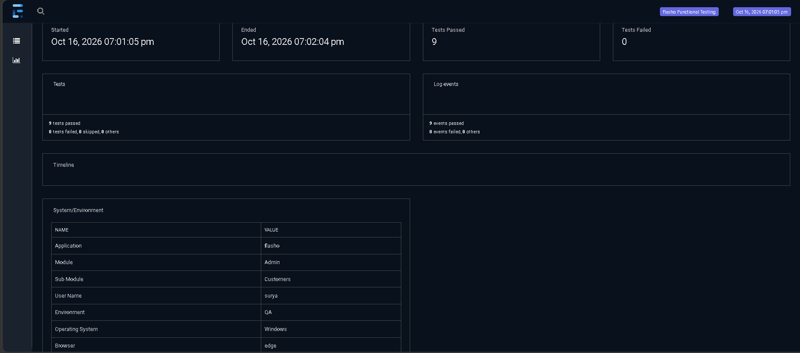
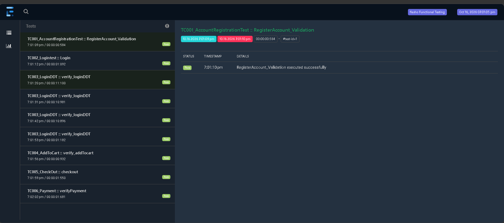

# GNC-Eats UI Automation Framework

A modular, data-driven UI test automation framework built for the **GNC-Eats** platform using **Java**, **Selenium WebDriver**, and **TestNG** based on the **Page Object Model (POM)** architectural pattern.

---

## 📊 Test Execution Reports

### Execution Summary Dashboard
Automated test run results captured via ExtentReports: **9 passed, 0 failed**.



### Test Suite Execution & DDT Iterations
Step-by-step breakdown across all test components, including parameterized data-driven login runs:



---

## 📌 Architecture & Design Patterns
- **Page Object Model (POM):** Decoupled web elements and page actions from test assertion logic for high maintainability.
- **Data-Driven Framework:** Externalized test inputs configured via Apache POI and Excel (`testdata/`) to test multiple scenarios without code changes.
- **Robust Execution Engine:** TestNG suite management (`testng.xml`) with prioritized execution, parallel configurations, and custom listeners.
- **Reporting & Logging:** ExtentReports integration for interactive dashboards, failure capture with screenshot listeners, and Log4j2 tracing.
- **Synchronizations:** Dynamic explicit waits (`WebDriverWait`) implemented across `BasePage` to handle asynchronous DOM updates and prevent flaky runs.

---

## 🧪 Automated Test Scenarios
- **TC001_AccountRegistrationTest:** New user registration, input validation, and account confirmation.
- **TC002_Logintest:** Standard user authentication and session validation.
- **TC003_LoginDDT:** Data-Driven Testing (DDT) running multiple valid and invalid credentials via Excel sheet iterations.
- **TC004_AddToCart:** Product catalog navigation, item selection, and cart state verification.
- **TC005_CheckOut:** Delivery address validation, cart order checkout, and price calculation.
- **TC006_Payment:** Payment method simulation and final order confirmation.

---

## 🛠️ Tech Stack & Dependencies
- **Language:** Java (JDK 1.8 / 17)
- **Automation Tool:** Selenium WebDriver
- **Testing Framework:** TestNG
- **Build Tool:** Apache Maven
- **Design Pattern:** Page Object Model (POM)
- **Data-Driven Engine:** Apache POI (Excel)
- **Reporting:** ExtentReports
- **Logging:** Log4j2

---

## 📂 Project Structure
```text
GNC-Eats UI Automation/
├── src/test/java/
│   ├── TestBase/               # Base test configuration & driver setup
│   ├── pageObjects/            # POM classes (locators & actions)
│   ├── testCases/              # Automated functional test scripts (TC001-TC006)
│   └── utilities/              # ExtentReports listener, DataProviders, ExcelUtility
├── src/test/resources/         # Configuration properties & environment settings
├── testdata/                   # Test data sheets (LoginIds.xlsx)
├── testng.xml                  # Test suite runner & listener configuration
├── pom.xml                     # Maven dependencies & build plugins
├── .gitignore                  # Git exclusions for test artifacts
└── README.md                   # Project documentation
